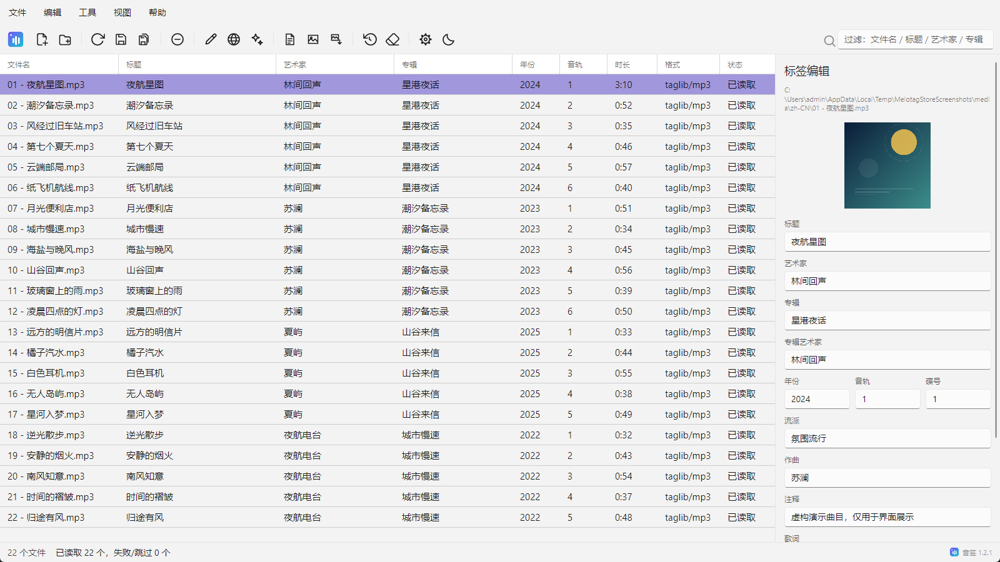

# 音签 Melotag 1.2.2

  

[GitHub 仓库](https://github.com/zdxiaoda/Melotag) · [Releases](https://github.com/zdxiaoda/Melotag/releases) · [更新日志](CHANGELOG.md) · [开发文档](AGENTS.md)

跨平台音乐标签编辑器，支持 Windows、Linux 和 Android。轻松整理音乐标签、封面与歌词，支持在线匹配、批量重命名、历史撤销与简繁转换。

## 项目优势

- **多端一致**：Windows、Linux 和 Android 共享统一的界面与操作体验。
- **轻量流畅**：基于 .NET 与 Avalonia，不使用 Electron 或 Chromium 外壳。
- **本地处理**：标签读写、保存和重命名都在设备上完成，无需上传音频。
- **高效整理**：支持批量匹配、批量保存、封面提取和模板/正则重命名。

## 下载与安装

前往 [Releases](https://github.com/zdxiaoda/Melotag/releases) 下载适合你设备的版本。

## 功能

### 文件与列表
- 添加文件 / 添加文件夹（递归）/ 拖放添加 / 命令行与“打开方式”
- 关键字过滤（文件名、标题、艺术家、专辑）
- 重新读取、从列表移除、全部保存、清空标签（内存）、批量提取封面
- 多选（Ctrl/Shift）+ `Delete` 批量移出列表；`Ctrl+C` 复制选中行为 Tab 分隔文本
- 状态列（已读取/已修改/已保存/失败/跳过）+ 错误提示

### 标签
- 读取/写入：标题、艺术家、专辑、专辑艺术家、年份、音轨、碟号、流派、注释、作曲、歌词、封面
- 音频属性：格式、时长、码率、采样率、声道、文件大小
- 写选项：ID3v2.3/2.4、保留文件修改时间、歌词写入标签、封面替换/清除

### 在线标签匹配
- 国内源：网易云音乐（标签/封面/歌词）、QQ 音乐（标签/歌词）、酷狗（标签/封面/歌词）、酷我（标签/封面）
- 国际源：MusicBrainz、Cover Art Archive、iTunes Search API、Last.fm、LRCLIB
- 单文件候选：多源结果列表，合并方式默认“全部覆盖”，同时带回歌词
- 批量自动匹配：先选择导入字段、在线源与覆盖方式，再逐文件匹配
- 在线源可单独启用/排序，支持一键恢复默认

### 歌词
- LRCLIB 搜索（同步歌词优先）
- LRC 处理：重排多时间戳、移除时间标签、删除空行、删除头部标签、整体偏移
- 导入 `.lrc`（自动识别 UTF-8/BOM/UTF-16/GB18030/Big5）
- 保存 `.lrc`（编码可选）、应用歌词到当前文件标签

### 封面
- 在线搜索（iTunes / Cover Art Archive）、本地选择、导出到文件、移除
- 体积上限、最大宽高、格式白名单；自动等比缩放与 JPEG 质量递减
- 保存时写回标签（ID3 APIC / Vorbis PICTURE / MP4 covr / ASF Picture）

### 重命名
- 模板 `@0–@8`（`@0` 不使用，`@1` 标题 … `@8` 专辑艺术家）
- 默认模板“歌手 - 歌名”（`@2 - @1`）
- 正则模式：捕获组映射到字段，实时预览
- 冲突自动加 ` (2)`；可选连带重命名 `.lrc` 与封面文件
- 反向模式：按文件名或正则写回标签

### 简繁转换
- 标签简→繁 / 繁→简（OpenCC，tw2 规则）
- 文件名简→繁 / 繁→简（连带 `.lrc` 与封面）

### 历史与撤销
- 每次保存/重命名写入 SQLite 快照
- 历史面板：查看、恢复选中快照、清空全部

### 设置与语言
- 中文 / 日本語 / English，首次启动跟随系统，切换后立即生效
- 设置按“搜索 / 在线源 / 歌词 / 封面 / 写入 / 界面”分类
- 启动时静默检查 GitHub Releases，也可手动检查更新
- 主题深/浅、紧凑行高、iTunes 商店国家等选项

## 支持的格式

MP3 / FLAC / APE / WavPack / TTA / MPC / OGG / Opus / MP4 / M4A / WAV / AIFF / WMA / DSF / DFF。

实际写入能力取决于 TagLib# 与容器；DSF/DFF 与多音轨文件有已知限制。

## 系统要求

- Windows 10 2004 或更高版本（x64）
- Linux x64（AppImage / Flatpak 自带运行时；deb / rpm / tar.gz 需要 .NET 10）
- Android 6.0 或更高版本

## 产品预览

  

## 开发

构建、测试、打包、Android 签名与 Microsoft Store 上架说明见 [AGENTS.md](AGENTS.md) 和 [docs/dev/](docs/dev/)。

## 许可证

本项目使用 [MIT License](LICENSE)。

Copyright (c) 2025-2026 zdxiaoda
